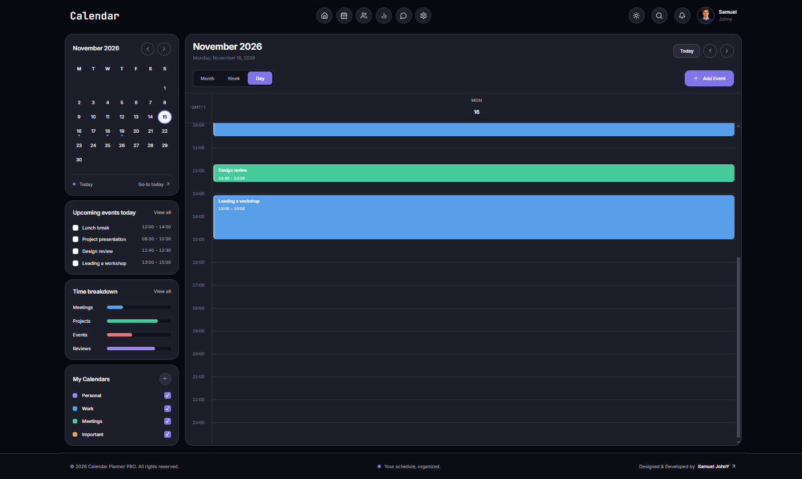

# 📅 Calendar Planner PRO

A modern, interactive calendar planner built with **HTML5, CSS3, and Vanilla JavaScript**.

Calendar Planner PRO helps users organize their schedules, create and manage events, switch between different calendar views, and track scheduled time across multiple categories.

The project focuses on DOM manipulation, state management, date handling, event rendering, local storage, and building a modern user interface without external JavaScript frameworks.

---

## 🌐 Live Demo

**[View Live Demo]()**

---

## 🖼️ Preview



_Calendar Planner PRO — modern calendar dashboard._

---

## ✨ Features

### 📆 Calendar Views

- **Month View** — display a complete monthly calendar.
- **Week View** — organize events in a seven-day timeline.
- **Day View** — focus on events scheduled for a specific day.
- Navigate between dates using calendar controls.
- Jump directly to today's date.
- Highlight the current and selected dates.

### 📝 Event Management

- Create new calendar events.
- Edit existing events.
- Delete events with confirmation.
- Assign event titles, descriptions, dates, and times.
- Organize events using calendar categories.
- Add optional event locations.
- Validate required inputs and event time ranges.

### ⏰ Event Rendering

- Display events according to their scheduled times.
- Position event cards inside the calendar timeline.
- Handle overlapping events using a custom layout algorithm.
- Display event titles and time ranges.
- Open events directly for editing.

### 🎨 My Calendars

- Organize events using predefined categories:
  - Personal
  - Work
  - Meetings
  - Important
- Enable or disable individual categories.
- Filter visible events based on active calendars.
- Use category-specific colors.

### 📊 Dashboard

- Display a list of upcoming events.
- Sort upcoming events chronologically.
- Show a weekly time breakdown by calendar category.
- Calculate scheduled duration and percentage distribution.
- Update dashboard information when events or active categories change.

### 🌙 Theme Management

- Dark Mode.
- Light Mode.
- Theme switching.
- Save the selected theme using Local Storage.
- Restore the preferred theme after reloading.

### 💾 Data Persistence

- Store events using the browser's Local Storage.
- Save active calendar categories.
- Preserve changes between page reloads.
- Load previously saved calendar information automatically.

---

## 🛠️ Technologies Used

| Technology          | Purpose                                   |
| ------------------- | ----------------------------------------- |
| HTML5               | Application structure and semantic markup |
| CSS3                | Layout, styling, animations, and themes   |
| JavaScript (ES6+)   | Application logic and DOM manipulation    |
| Local Storage API   | Browser-based data persistence            |
| JavaScript Date API | Date calculations and navigation          |
| Lucide Icons        | User interface icons                      |
| Google Fonts        | Typography                                |

No frontend framework is required.

---

## 📂 Project Structure

```text
calendar-planner-pro/
│
├── index.html
├── style.css
├── script.js
├── README.md
├── LICENSE
│
└── assets/
    ├── avatar.png
    └── preview.png
```

The preview image is a screenshot of the finished application and should be added before publishing.

---

## 🚀 Getting Started

### 1. Clone the Repository

```bash
git clone https://github.com/JohnyIsBackk/calendar-planner-pro.git
```

### 2. Navigate to the Project

```bash
cd calendar-planner-pro
```

### 3. Run the Application

Open `index.html` in your browser.

You can also use the **Live Server** extension in Visual Studio Code.

No installation, build process, or package dependencies are required.

---

## 🧠 How It Works

### Application State

The application uses JavaScript variables and arrays to manage:

- Calendar events.
- Available calendars.
- Active calendar filters.
- Current and selected dates.
- Current calendar view.
- Event editing state.

### Date Handling

Custom date helper functions support:

- Date formatting.
- Weekly date calculations.
- Month navigation.
- Time conversion.
- Event duration calculation.

### Event Layout

The calendar includes custom logic for displaying overlapping events.

Events are compared by their start and end times, grouped according to overlaps, and positioned in available columns.

### Rendering

The application dynamically generates calendar elements using JavaScript.

DOM updates are used to display events, navigate dates, filter calendars, and update dashboard content.

### Local Storage

Event information and calendar preferences are stored locally in the browser.

Changes remain available after refreshing the page.

---

## 📌 Current Scope

The main functionality includes calendar navigation, three calendar views, event CRUD operations, category filtering, time breakdowns, and theme switching.

Some interface controls, including Search, Notifications, View All, and Add Calendar, are reserved for future functionality.

The application is a frontend portfolio project. It does not currently provide cloud synchronization, user accounts, or a backend database.

---

## 🔮 Possible Future Improvements

- Event search and advanced filtering.
- Custom calendar creation.
- Event completion tracking.
- Drag-and-drop event rescheduling.
- Calendar export and import.
- Recurring events.
- Cloud synchronization.
- Improved accessibility and mobile usability.

---

## 👨‍💻 Author

**Samuel Jahn — Frontend Developer**

- 🌐 Portfolio: [samueljahn.sk](https://samueljahn.sk)
- 💻 GitHub: [JohnyIsBackk](https://github.com/JohnyIsBackk)
- 📄 Developer CV: [View CV](https://johnyisbackk.github.io/frontend-developer-cv/)

---

## 📄 License

This project is licensed under the **MIT License**.

See the [LICENSE](LICENSE) file for details.

---

⭐ If you find this project useful, consider giving the repository a star.
